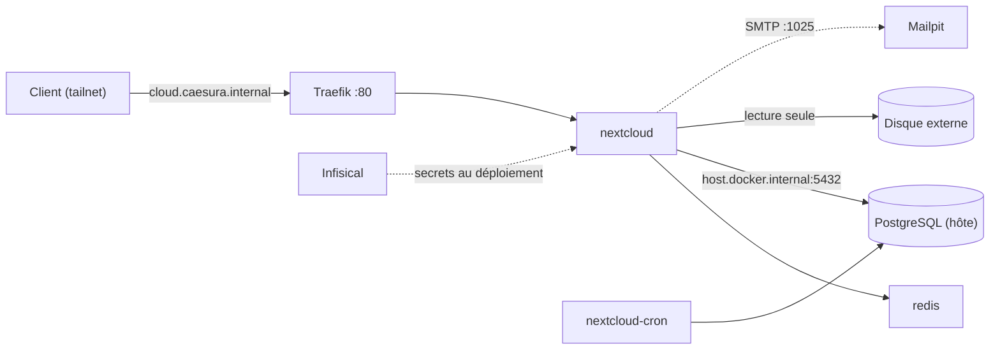

# Nextcloud (homelab)

[English version](README.md)

[Nextcloud](https://nextcloud.com/) sur un Raspberry Pi 5, pour **consulter le contenu d'un disque dur externe** (documents, musique, photos) depuis n'importe quel appareil du tailnet. Il réutilise les services mutualisés du homelab : PostgreSQL natif, Traefik, DNS interne, Mailpit et Infisical. Aucune exposition publique.

## Vue d'ensemble

| Service | Image | Rôle | Plafond mémoire |
|---|---|---|---|
| `nextcloud` | `nextcloud:<majeure>-apache` | Application web | 1 Go |
| `nextcloud-cron` | même image, entrypoint `/cron.sh` | Tâches de fond toutes les 5 min | 256 Mo |
| `redis` | `redis:7-alpine` | Verrouillage de fichiers et cache, sans persistance | 64 Mo |

- **Base de données** : le PostgreSQL natif de l'hôte (un rôle et une base par application, pas de conteneur Postgres dédié).
- **Accès** : `http://cloud.caesura.internal` (Traefik + DNS interne), ou directement `http://<TAILSCALE_IP>:8180`. Les ports sont liés à localhost et à l'adresse Tailscale uniquement, jamais à `0.0.0.0`.
- **Secrets** : `NEXTCLOUD_DB_PASS` et `NEXTCLOUD_ADMIN_PASSWORD` vivent dans Infisical et sont injectés par `deploy.sh` ; rien de sensible n'est stocké dans le dépôt.
- **Mail** : les mails de réinitialisation de mot de passe vont vers le Mailpit mutualisé (projet `mailpit`), rien n'est livré sur Internet.



## Comment le disque est exposé

- Seuls les dossiers choisis sont montés, en **lecture seule**, sous `/mnt/disque/*` dans le conteneur (`Documents`, `Musiques`, `Photos`). Le disque entier n'est jamais monté : il peut aussi contenir les données Docker, des dumps de base ou des fichiers swap.
- Ils ne sont pas consultables par défaut : activer l'app **External storage support** et ajouter un montage **Local** par dossier.
- Le répertoire de données de Nextcloud est un bind mount distinct (`DATA_PATH`) sur le même disque, propriété de `www-data` (uid 33), mode `750`.
- Avec un montage en lecture seule, Nextcloud ne peut ni modifier ni supprimer les fichiers d'origine, quoi qu'il arrive dans l'interface web.

## Prérequis

- Docker Compose et le réseau externe `traefik-net` (déjà présent si Traefik tourne).
- Les projets DNS interne et Traefik (`*.caesura.internal`), et un Mailpit mutualisé.
- Un PostgreSQL natif joignable depuis Docker, un projet Infisical avec un environnement `prod`, et le [CLI Infisical](https://infisical.com/docs/cli/overview) sur la machine qui lance `deploy.sh`.
- Environ 1,5 Go de RAM libre. À vérifier d'abord avec `free -h` et `docker stats --no-stream`.

## Déploiement

### 1. Base de données (sur l'hôte)

Créer un rôle et une base (voir `postgres-setup.sql`), avec un mot de passe généré que tu ranges aussi dans Infisical sous `NEXTCLOUD_DB_PASS` :

```bash
sudo -u postgres psql -f postgres-setup.sql
```

Autoriser le sous-réseau du compose (`172.27.30.0/24`, fixé dans `docker-compose.yml` ; vérifier qu'il est libre avec `docker network inspect`) dans `pg_hba.conf`, puis dans le pare-feu :

```bash
echo "host    nextcloud    nextcloud_app    172.27.30.0/24    scram-sha-256" | sudo tee -a /etc/postgresql/17/main/pg_hba.conf
sudo ufw allow from 172.27.30.0/24 to any port 5432 proto tcp comment 'nextcloud -> shared postgres'
sudo systemctl reload postgresql
```

Vérifier que la règle est lue sans erreur :

```bash
sudo -u postgres psql -c "SELECT line_number, database, user_name, address, error FROM pg_hba_file_rules WHERE database::text LIKE '%nextcloud%';"
```

### 2. Répertoire de données (sur l'hôte)

```bash
sudo mkdir -p /mnt/storage/nextcloud-data
sudo chown 33:33 /mnt/storage/nextcloud-data
sudo chmod 750 /mnt/storage/nextcloud-data
```

Vérifier que les dossiers montés sont lisibles par tous (fichiers `o+r`, dossiers `o+rx`), et que le disque est monté avant le démarrage des conteneurs, sinon Docker créerait les dossiers sur le disque système.

### 3. Secrets

Dans Infisical, environnement `prod` : `NEXTCLOUD_DB_PASS` (même valeur que le rôle de la base) et `NEXTCLOUD_ADMIN_PASSWORD`. Créer une Machine Identity `nextcloud-deploy` (Universal Auth) avec un accès en **lecture seule** au projet, puis :

```bash
cp .infisical-identity.env.example .infisical-identity.env   # Client ID/Secret, ID du projet, URL
cp .env.example .env                                          # valeurs Tailscale, chemins du disque
```

Test à blanc (secrets injectés, rien n'est démarré) :

```bash
infisical run --env=prod -- docker compose config -q
```

### 4. Démarrer

```bash
./deploy.sh
docker logs -f nextcloud     # le premier démarrage lance l'installation (quelques minutes)
```

### 5. Première configuration

1. Se connecter avec `NEXTCLOUD_ADMIN_USER` et `NEXTCLOUD_ADMIN_PASSWORD`.
2. Paramètres d'administration → Paramètres de base → Tâches en arrière-plan : choisir **Cron** (le conteneur `nextcloud-cron` l'exécute).
3. Applications : activer **External storage support**, puis Paramètres d'administration → Stockage externe : ajouter un montage **Local** pour chacun de `/mnt/disque/Documents`, `/mnt/disque/Musiques` et `/mnt/disque/Photos`.

## Fichiers

- `docker-compose.yml` : les trois services, un sous-réseau fixe, des plafonds mémoire, `no-new-privileges`.
- `deploy.sh` : authentification Infisical, puis `docker compose up -d` avec les secrets injectés.
- `.env.example` : réglages non secrets (valeurs Tailscale, versions, chemins).
- `.infisical-identity.env.example` : modèle des identifiants de la Machine Identity (le vrai fichier n'est jamais commité).
- `postgres-setup.sql` : création du rôle et de la base.

## Dépannage

| Symptôme | Cause probable |
|---|---|
| `password authentication failed` dans les logs | Le secret Infisical et le mot de passe du rôle diffèrent : réinitialiser le mot de passe du rôle depuis le secret |
| « Accès via un domaine non approuvé » | L'hôte utilisé manque dans `NEXTCLOUD_TRUSTED_DOMAINS` (`docker-compose.yml`) |
| 403 d'Infisical au déploiement | La Machine Identity n'a pas le rôle de lecture sur le projet ou l'environnement |
| L'installateur échoue sur le répertoire de données | Mauvais propriétaire ou mode sur `DATA_PATH` (attendu : `33:33`, `750`) |
| Changement du mot de passe admin ignoré | `NEXTCLOUD_ADMIN_PASSWORD` n'est lu qu'à la première installation : passer par l'interface ou `occ user:resetpassword` |

## Notes de sécurité

- Rien sur `0.0.0.0` : localhost et adresse Tailscale uniquement, accès via le tailnet (chiffré par WireGuard), d'où le HTTP simple derrière Traefik.
- Dossiers du disque montés en lecture seule ; répertoire de données propriété de `www-data`, mode `750`.
- Un rôle PostgreSQL par application, autorisé uniquement depuis le sous-réseau du compose.
- Conteneurs avec `no-new-privileges` et plafonds mémoire ; images à figer par digest après le premier pull (voir les commentaires `TODO`).
- Ne jamais commiter `.env` ni `.infisical-identity.env` (tous deux ignorés).

## Licence

[MIT](LICENSE)
