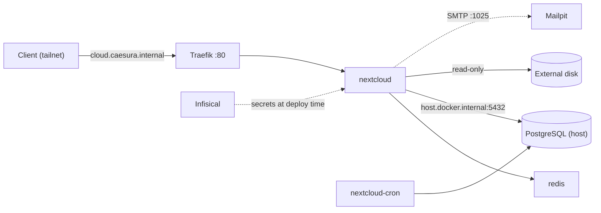

# Nextcloud (homelab)

[Version française](README.fr.md)

[Nextcloud](https://nextcloud.com/) on a Raspberry Pi 5, used to **browse the content of an external hard drive** (documents, music, photos) from any device of the tailnet. It reuses the homelab's shared services: native PostgreSQL, Traefik, internal DNS, Mailpit and Infisical. No public exposure at all.

## Overview

| Service | Image | Role | Memory cap |
|---|---|---|---|
| `nextcloud` | `nextcloud:<major>-apache` | Web app | 1 GB |
| `nextcloud-cron` | same image, `/cron.sh` entrypoint | Background jobs every 5 min | 256 MB |
| `redis` | `redis:7-alpine` | File locking and cache, no persistence | 64 MB |

- **Database**: the host's native PostgreSQL (one role and one database per application, no dedicated Postgres container).
- **Access**: `http://cloud.caesura.internal` (Traefik + internal DNS), or directly `http://<TAILSCALE_IP>:8180`. Ports are bound to localhost and to the Tailscale address only, never to `0.0.0.0`.
- **Secrets**: `NEXTCLOUD_DB_PASS` and `NEXTCLOUD_ADMIN_PASSWORD` live in Infisical and are injected by `deploy.sh`; nothing sensitive is stored in the repository.
- **Mail**: password-reset mails go to the shared Mailpit sink (see the `mailpit` project), nothing is delivered to the internet.



## How the disk is exposed

- Only chosen folders are mounted, **read-only**, under `/mnt/disque/*` in the container (`Documents`, `Musiques`, `Photos`). The whole disk is never mounted: it may also hold Docker data, database dumps or swap files.
- They are not browsable by default: enable the **External storage support** app and add one **Local** mount per folder.
- Nextcloud's own data directory is a separate bind mount (`DATA_PATH`) on the same disk, owned by `www-data` (uid 33), mode `750`.
- Mounting read-only means Nextcloud cannot modify or delete the original files, whatever happens in the web UI.

## Prerequisites

- Docker Compose, and the external `traefik-net` network (already there if Traefik runs).
- The internal DNS and Traefik projects (`*.caesura.internal`), and a shared Mailpit.
- A native PostgreSQL reachable from Docker, an Infisical project with a `prod` environment, and the [Infisical CLI](https://infisical.com/docs/cli/overview) on the machine that runs `deploy.sh`.
- About 1.5 GB of free RAM. Check with `free -h` and `docker stats --no-stream` first.

## Deployment

### 1. Database (on the host)

Create a role and a database (see `postgres-setup.sql`), with a generated password that you also store in Infisical as `NEXTCLOUD_DB_PASS`:

```bash
sudo -u postgres psql -f postgres-setup.sql
```

Allow the compose subnet (`172.27.30.0/24`, fixed in `docker-compose.yml`; check that it is unused with `docker network inspect`) in `pg_hba.conf`, then in the firewall:

```bash
echo "host    nextcloud    nextcloud_app    172.27.30.0/24    scram-sha-256" | sudo tee -a /etc/postgresql/17/main/pg_hba.conf
sudo ufw allow from 172.27.30.0/24 to any port 5432 proto tcp comment 'nextcloud -> shared postgres'
sudo systemctl reload postgresql
```

Verify the rule is parsed without error:

```bash
sudo -u postgres psql -c "SELECT line_number, database, user_name, address, error FROM pg_hba_file_rules WHERE database::text LIKE '%nextcloud%';"
```

### 2. Data directory (on the host)

```bash
sudo mkdir -p /mnt/storage/nextcloud-data
sudo chown 33:33 /mnt/storage/nextcloud-data
sudo chmod 750 /mnt/storage/nextcloud-data
```

Make sure the mounted folders are readable by everyone (files `o+r`, directories `o+rx`), and that the disk is mounted before the containers start, otherwise Docker would create the folders on the system drive.

### 3. Secrets

In Infisical, `prod` environment: `NEXTCLOUD_DB_PASS` (same value as the database role) and `NEXTCLOUD_ADMIN_PASSWORD`. Create a Machine Identity `nextcloud-deploy` (Universal Auth) with **read-only** access to the project, then:

```bash
cp .infisical-identity.env.example .infisical-identity.env   # Client ID/Secret, project ID, URL
cp .env.example .env                                          # Tailscale values, disk paths
```

Dry run (secrets injected, nothing started):

```bash
infisical run --env=prod -- docker compose config -q
```

### 4. Start

```bash
./deploy.sh
docker logs -f nextcloud     # the first start runs the installer (a few minutes)
```

### 5. First configuration

1. Sign in with `NEXTCLOUD_ADMIN_USER` and `NEXTCLOUD_ADMIN_PASSWORD`.
2. Administration settings → Basic settings → Background jobs: choose **Cron** (the `nextcloud-cron` container runs it).
3. Apps: enable **External storage support**, then Administration settings → External storage: add one **Local** mount for each of `/mnt/disque/Documents`, `/mnt/disque/Musiques` and `/mnt/disque/Photos`.

## Files

- `docker-compose.yml`: the three services, a fixed subnet, memory caps, `no-new-privileges`.
- `deploy.sh`: Infisical authentication, then `docker compose up -d` with secrets injected.
- `.env.example`: non-secret settings (Tailscale values, versions, paths).
- `.infisical-identity.env.example`: Machine Identity credentials template (real file never committed).
- `postgres-setup.sql`: role and database creation.

## Troubleshooting

| Symptom | Likely cause |
|---|---|
| `password authentication failed` in the logs | The Infisical secret and the database role password differ: reset the role password from the secret |
| "Access through untrusted domain" | The host used is missing from `NEXTCLOUD_TRUSTED_DOMAINS` in `docker-compose.yml` |
| 403 from Infisical at deploy | The Machine Identity lacks the read role on the project or environment |
| Installer fails on the data directory | Wrong owner or mode on `DATA_PATH` (expected `33:33`, `750`) |
| Admin password change ignored | `NEXTCLOUD_ADMIN_PASSWORD` is only read at the first install: use the UI or `occ user:resetpassword` |

## Security notes

- Nothing on `0.0.0.0`: localhost and Tailscale address only, access over the tailnet (WireGuard-encrypted), hence plain HTTP behind Traefik.
- Disk folders mounted read-only; data directory owned by `www-data`, mode `750`.
- One PostgreSQL role per application, allowed only from the compose subnet.
- Containers run with `no-new-privileges` and memory caps; images are to be pinned by digest after the first pull (see the `TODO` comments).
- Never commit `.env` or `.infisical-identity.env` (both ignored).

## License

[MIT](LICENSE)
